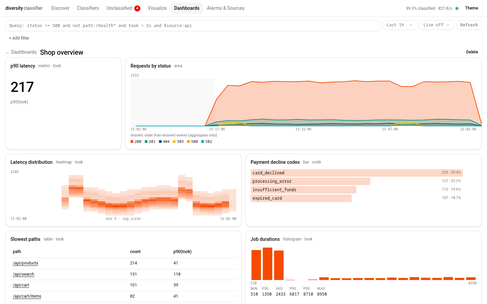
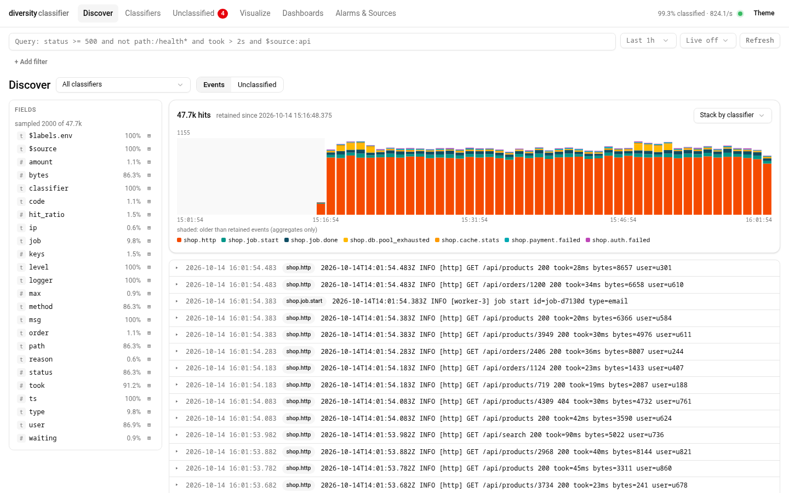
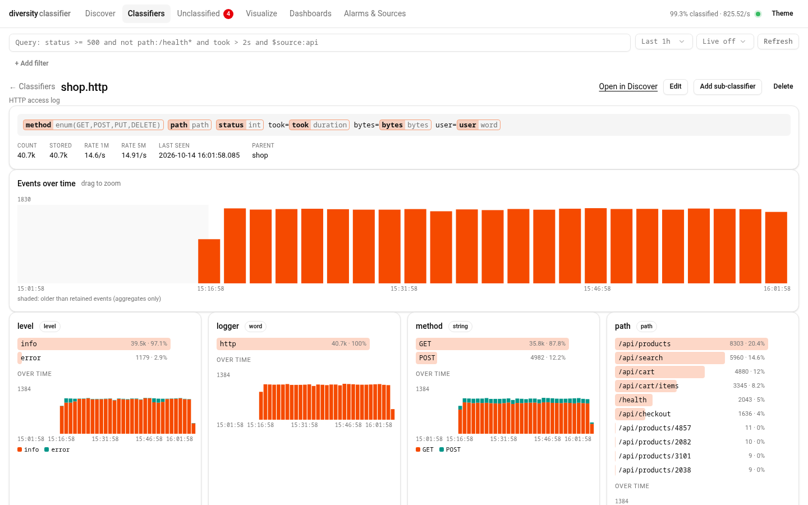
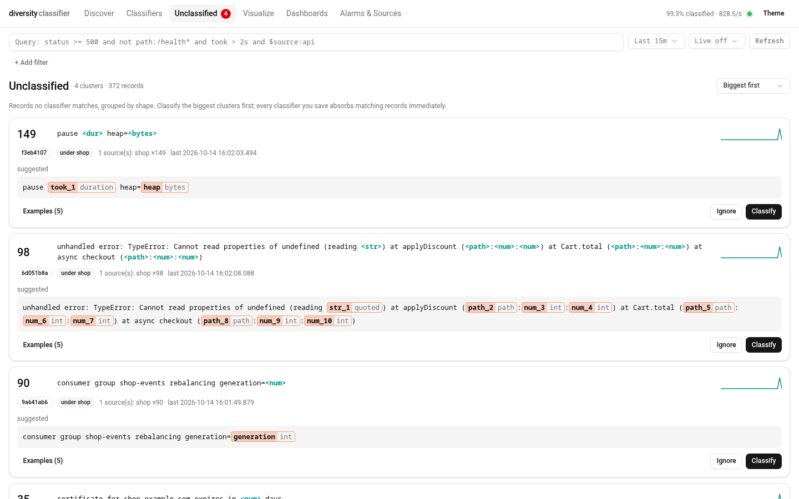
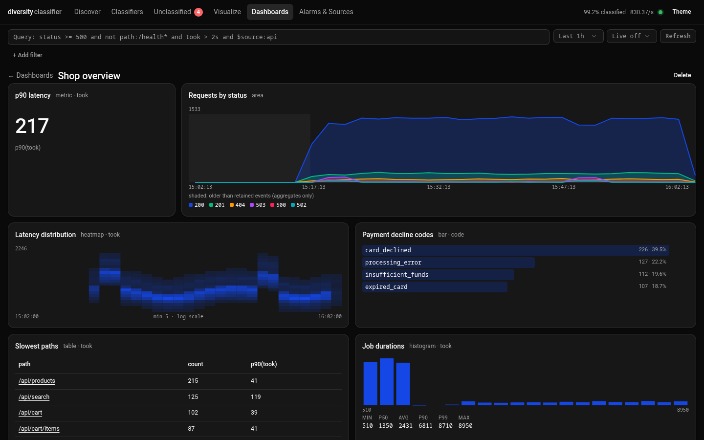

# diversity-classifier

**Let an AI agent watch your logs without reading them.**

LLM agents can't consume a stream, and pasting logs into context is slow and
expensive. But logs are mostly the same few templates repeated millions of
times. diversity-classifier is an [MCP](https://modelcontextprotocol.io)
server that sits on your log streams, lets the agent **teach it those
templates once**, and from then on does the cheap work itself: matching,
counting, aggregating and alerting.

The agent only ever sees:

- **lines nothing matches**, deduplicated into clusters such as
  `×4,812  client <uuid> failed to connect to <ip>:<num> after <dur>`, each with
  a ready-to-edit template, and
- **aggregates and alarms** over everything it already understands.

The unclassified queue is the agent's to-do list. Every classifier it defines
absorbs matching lines immediately, including the backlog, so the queue
shrinks toward zero and so does the cost of watching.

```
 ssh prod journalctl -f ─┐
 kubectl logs -f ... ────┼─► classifier engine ─┬─► events ─► search · histograms · timeseries · alarms ─► 🔔 agent
 tail -F app.log ────────┘   (templates,        │
                              envelopes)        └─► unclassified clusters ─► debounced digest ─► 🔔 agent
                                                     ▲                                │
                                                     └── define_classifier ◄──────────┘
```

A Kibana-style **web UI** lets humans explore the same data: Discover,
per-field histograms, timeseries, dashboards the agent can build for you.



## Quick start (Claude Code)

```sh
# in your project (Node >= 20):
claude mcp add logs -- npx -y @nemanjan00/diversity-streamer

# …or with the web UI on http://127.0.0.1:7070 while the session runs:
claude mcp add logs -- npx -y @nemanjan00/diversity-streamer --http 7070
```

Published on npm as [`@nemanjan00/diversity-streamer`](https://www.npmjs.com/package/@nemanjan00/diversity-streamer).
The state file is created in the directory Claude Code starts the server in,
i.e. your project (`.claude/diversity-classifier.json`).

**Other MCP clients / `.mcp.json`:**

```json
{
  "mcpServers": {
    "logs": {
      "command": "npx",
      "args": ["-y", "@nemanjan00/diversity-streamer", "--http", "7070"]
    }
  }
}
```

**Updating.** npx caches the version it downloaded first. Pin
`@nemanjan00/diversity-streamer@latest` (or an exact version) in the command
to pick up new releases, then reconnect the server (`/mcp` in Claude Code).

**Standalone**, without an agent (explore logs in the web UI; stop with Ctrl+C):

```sh
npx -y @nemanjan00/diversity-streamer --http 7070 --cmd "api=ssh prod-1 journalctl -fu api -o short-iso"
```

Then ask: *"Watch the API logs on prod-1 (`ssh prod-1 journalctl -fu api -o short-iso`), classify what's there and alert me on anything unusual."*

**Push notifications.** The server pushes digests and alarm firings as
[Claude Code channel](https://docs.claude.com/en/docs/claude-code) messages,
so the agent reacts without polling. Enable it for this server with:

```sh
claude --dangerously-load-development-channels server:logs
```

Without channels everything still works. Notifications also go out as
standard MCP log messages, and the agent can poll `stats` and
`get_unclassified`.

## How the agent works with it

1. **Point it at streams**: `add_source { name: "api", type: "command", command: "ssh prod-1 journalctl -fu api -o short-iso" }`.
   Files (`tail -F`), TCP and Unix sockets, and pasted lines (`ingest`) work too.
2. **Look at the queue**: `get_unclassified` returns clusters sorted by count,
   each with a `suggested_template`.
3. **Factor out the line head once**:
   ```jsonc
   define_parser     { "name": "head", "template": "^{ts:timestamp} {level:level} [{logger:word}]" }
   define_classifier { "name": "app", "template": "{...head} {msg:rest}", "envelope": true, "time_field": "ts" }
   ```
   Lines matching only the envelope stay unclassified, but they are now
   clustered by message body, so timestamps never fragment clusters.
4. **Test, then define**:
   ```jsonc
   test_classifier   { "parent": "app", "template": "client {client:uuid} failed to connect to {peer:hostport} after {took:duration}" }
   define_classifier { "name": "app.conn_failed", "parent": "app", "template": "…" }
   // → { "retro": { "absorbed": 4812, "queue": { "before": {...}, "after": {...} } } }
   ```
   When a template doesn't match, `near_misses` say exactly where it fails:
   `"matched_up_to": "… {client:uuid} whitespace \"failed\" …", "failed_at": "{peer:hostport}"`.
5. **Ask questions** with a KQL-like query language:
   ```jsonc
   histogram  { "classifier": "app.http", "field": "status" }
   timeseries { "classifier": "app.http", "q": "took > 2s", "split_by": "$labels.pod", "interval": "1m" }
   search_events { "q": "status >= 500 and not path:/health* and $source:api" }
   sequences  { "first": "app.job_start", "then": "app.job_done", "key": "worker" }   // per-worker gap stats
   ```
6. **Set alarms**: `rate`, `threshold` (e.g. p90 of `took` > 2s over 5m),
   `new_value` (a never-seen client id), `absence` (heartbeat stopped),
   `sequence` (A then B with the same `request_id`), `source_silent` and
   `unclassified`.
7. **Wait.** With channels, unclassified digests are pushed (debounced) and
   alarm firings immediately. Without channels, the agent calls `wait`, which
   blocks until a new cluster, an alarm or a source failure.

Everything the agent defines is **persisted** in `./.claude/diversity-classifier.json`.
You can commit it to share the classifier pack with your team. Reusable heads
can go in a global file shared across projects. On the next run the server
starts with the same definitions.

## Template language

```
{name:type}                 typed capture             {status:int} {took:duration} {client:uuid}
{name:type(args)}           parameterised             {method:enum(GET,POST)} {id:regex([A-Z]{3}-\d+)}
{name:type|filter|...}      converter pipeline        {svc:word|lower|map(gw=gateway)}
{name?:type}                optional                  {name:/regex/flags}   inline regex
{_:type}  {*}               match, don't keep         {...parser}           spread a parser's fields
{{ }}                       literal braces            whitespace runs match \s+, ^ and $ anchor
```

**Built-in types:** `word text rest int float number hex bool uuid ip ipv4 ipv6 host port email url path pathname qs iso8601 timestamp duration bytes level quoted json kv enum regex`.
`duration` → ms, `bytes` → bytes, `timestamp` handles ISO, syslog, CLF and epoch
→ epoch ms, and `level` normalises `WARNING`/`W`/`warn` → `warn`. `json` and `kv`
flatten into `name.key` fields.

**Custom parsers** are either a regex with converters, or a template, which
gives you composition: `{ "name": "hostport", "template": "{host:host}:{port:port}" }`
and then `{peer:hostport}` → `peer.host`, `peer.port`.

**Sub-classifiers** refine a parent's field: a `http` classifier with
`{path:path}`, plus a child `http.admin` with `on: "path"` and template
`^/admin/{section:word}`.

**HTTP routes and query parameters.** `pathname` stops at `?`, and `qs`
parses the query string (URL-decoded, repeated keys become lists, numbers are
converted). One child per route gives you path variables; children are tried
in priority order, and unmatched paths stay on the parent:

```jsonc
{ "name": "http", "template": "{method:word} {path:pathname}{q?:qs} {status:int} took={took:duration}" }
{ "name": "http.product", "parent": "http", "on": "path", "template": "^/api/products/{id:int}$" }
{ "name": "http.order_item", "parent": "http", "on": "path", "template": "^/api/orders/{order:uuid}/items/{item:int}$" }
// GET /api/search?q=red+shoes&page=2 → path "/api/search", q.q "red shoes", q.page 2
// per-route latency: timeseries { classifier: "http", split_by: "classifier", agg: "p90", field: "took" }
```

**New routes surface on their own.** Add `"residual": "path"` to the `http`
classifier. Requests that match no route child still count as `http` events,
and their paths are also clustered in the queue as *residual* clusters:

```
[3f2a91c0] new ×412 (http · unmatched path)  /api/reports/<num>/export
  suggested_template: ^/api/reports/{report:int}/export$
```

Defining that child (parent `http`, `on: "path"`) moves the matching stored
events onto the new route and clears the cluster. The digest also reports new
residual clusters, so the agent hears about a new route as soon as it
shows up.

## Stack traces behind prefixes

When every line carries a prefix (container, task, pod, worker), put the
multiline rule on the envelope. It runs on the body, after the prefix is
stripped, and keeps one pending record per `group_by` value:

```jsonc
{ "name": "app", "template": "^[{worker:word}] {msg:rest}", "envelope": true,
  "multiline": { "continue": "^\\s+at |^\\s*}", "group_by": ["worker"] } }
```

## Secrets

Records are redacted **before** anything is stored. Bearer/basic credentials,
`user:pass@` in URLs, `password=`/`token=`/`api_key=` pairs, JWTs and PEM
private keys become `[REDACTED]` by default. `set_redaction` adds patterns or
turns it off, and classifiers can mask specific fields with
`redact: ["field"]`.

## Multistream

Run any number of sources at once. Every record carries `$source` and
`$labels`. `demux` splits one combined stream into many, e.g.
`kubectl logs --prefix` into one stream per pod:

```jsonc
{ "name": "k8s", "type": "command", "command": "kubectl logs -f -l app=api --prefix --all-containers",
  "demux": { "regex": "^\\[(?<pod>[^\\]]+)\\]\\s", "label": "pod", "strip": true },
  "multiline": { "continue": "^\\s" } }
```

The same unknown message from 20 pods appears as one cluster, with per-pod
counts.

## Web UI

```sh
npx -y @nemanjan00/diversity-streamer --http 7070      # or let the agent call the web_ui tool
```

- **Discover**: query bar, time picker, live mode, a hits histogram, a field
  sidebar with top values and +/− filters, and an expandable event table.
  Field values are highlighted in each line: click one to filter for it,
  Alt/Shift-click to exclude it. Opening an event pauses live mode until you
  resume.
- **Click to filter everywhere**: bars, histogram buckets, table cells,
  legend entries, a series inside a line/area/stacked chart, and heatmap
  cells (value range + time). All panels on a page share the filters, so one
  click narrows the whole dashboard. Drag across a time chart to zoom.
- **Classifiers**: an explorer tree and per-classifier pages with one
  histogram and one over-time panel per field. Panels cross-filter: click
  `status=503` to see which hosts and latencies go with it. Also includes an
  editor with live testing.
- **Visualize**, **Dashboards**: the agent can create dashboards with
  `define_dashboard`.
- **Unclassified** (Classify / Ignore), **Alarms**, **Sources**.

| | |
|---|---|
|  |  |
| **Discover**: hits over time (stacked by classifier), field sidebar, events | **Classifier**: typed template and one panel per field; clicks cross-filter |
|  |  |
| **Unclassified**: the agent's to-do list, with suggested templates; joined stack traces are one cluster | **Dashboards**, light and dark |

The screenshots show synthetic logs from a fictional shop
(`scripts/demo/generate.js`). Regenerate them with `yarn screenshots`, or
try the UI yourself:

```sh
# from a clone, terminal 1: the server (stdio stays attached to the terminal)
node bin/mcp.js --http 7070 --no-global --state /tmp/demo.json

# terminal 2: seed it like an agent would, then stream demo logs; open http://127.0.0.1:7070
node scripts/demo/seed.js http://127.0.0.1:7070 --demo
```

It binds to `127.0.0.1` by default. A non-loopback bind requires `--token`, and
`--read-only` disables edits. Built with
[qrp-shadcdn](https://github.com/nemanjan00/qrp-shadcdn), so there is no build
step and it works offline.

## CLI

```
npx -y @nemanjan00/diversity-streamer [options]
  --cmd "[name=]command"      --file "[name=]path"      --tcp "[name=][host:]port"      --unix "[name=]path"
  --state <path>              --global-state <path>     --no-global
  --http [host:]port          --token <secret>          --read-only
  --no-commands               forbid adding command sources through tools / UI
  --resume-sources            auto-start command sources saved in state files
```

Tuning goes through env vars (`DC_EVENTS_TOTAL`, `DC_UNCLASSIFIED_BUFFER`,
`DC_DIGEST_QUIET_MS`, …). See `--help`.

## Security notes

- `command` sources run shell commands as the user running the server, which
  is the same trust level the agent already has in a coding session.
  `--no-commands` limits the agent to sources given on the command line.
- Command sources saved in a state file **load paused**. A cloned repo with a
  malicious `.diversity-classifier.json` therefore cannot execute anything on
  startup. The agent (or you) resumes them with `start_source`, or you opt in
  with `--resume-sources`.

## Where the agent can get hurt

Some traps can't be fixed by the tool because the data itself is
ambiguous. They're listed here, and in the server instructions every agent
reads, so they get treated with care:

- **Absence is not health.** A quiet period can mean nothing happened, or that
  the component that would log is stuck or dead (no "acquired" lines while
  nobody acquires anything). Silence has to be explained with other evidence:
  source health, `last_seen` of related classifiers, the events that *should*
  accompany it.
- **Empty can be your filter.** A gap under a `q`/`where`/classifier/time
  filter may only exist in the filtered view. Re-run without the filter before
  concluding anything.
- **Retention.** Queries see retained events only (`retained_since`); older
  data exists only as counters and aggregates.
- **Restarts forget.** Events, the queue and metrics live in memory.
  Definitions and `new_value` history persist, evidence does not. Writing raw
  logs to disk is a deliberate non-goal.
- **Catch-all classifiers** absorb every future variant too, so new message
  shapes never reach the queue. Prefer one typed template per message kind.
- **First top-level match wins.** Once an envelope claims a line, a new
  top-level classifier for it never runs; attach it as a child instead
  (`define_classifier` warns when this happens).
- **Count-only classifiers** keep no events. **Retro-absorbed** records never
  fire alarms.
- **Multi-line records** are only joined when configured, and some formats
  can't be joined reliably at all. Unjoined fragments appear as separate
  clusters.
- **Time.** Zone-less timestamps are read as local time unless the type says
  otherwise (`{ts:timestamp(utc)}`).
- **Redaction** is pattern-based. It catches common credential shapes, not
  everything sensitive.

## How much can it take?

Measured on one core (Node 26, synthetic lines with a shared head, an
envelope and typed child templates):

| Workload | Throughput |
|---|---|
| 10 classifiers | ~100k lines/s |
| 50 classifiers | ~86k lines/s |
| 100 classifiers (incl. 20% unknown lines) | ~77k lines/s |

| Query over a full store (200k events) | Time |
|---|---|
| `search_events` with `q` | ~65 ms |
| exact `histogram` over all events | ~85 ms |
| `timeseries` split by a field | ~75 ms |
| `field_summary` | ~50 ms |

Things to know at volume:

- **Retention is counted in events, not time.** The default store keeps 200k
  events (`DC_EVENTS_TOTAL`, roughly 0.6–1.5 kB each), so at 1,000 lines/s
  exact queries cover the last ~3 minutes. Counters and all-time aggregates
  (counts, rates, top values, percentiles) cover everything. Raise the limit
  if you have the memory, or use `store: "count"` for high-volume noise.
- **Everything runs on one thread.** Queries pause ingestion for their
  duration. Sources are read with backpressure, so a burst means lag, not lost
  lines (the producer, e.g. `ssh`, waits).
- **The unclassified queue** keeps the last 20k unknown records
  (`DC_UNCLASSIFIED_BUFFER`). Older unknown records survive only as cluster
  counts, so retroactive classification can't reach them.

## Limits (by design)

This is a developer tool, not a log store. Events live in bounded ring buffers
(`DC_EVENTS_TOTAL`, default 200k). All-time counters and field aggregates are
kept beyond that, but there is no long-term retention. Use Loki or Elastic for
history.

## Development

```sh
git clone https://github.com/nemanjan00/diversity-classifier.git
cd diversity-classifier && yarn install   # dev tooling needs Node >= 22.18
claude mcp add logs-dev -- node "$PWD/bin/mcp.js"

yarn test        # jest
yarn lint        # eslint
yarn mcp-watch   # nodemon -q bin/mcp.js
```

See [SPEC.md](SPEC.md) for the full design.

## License

MIT
